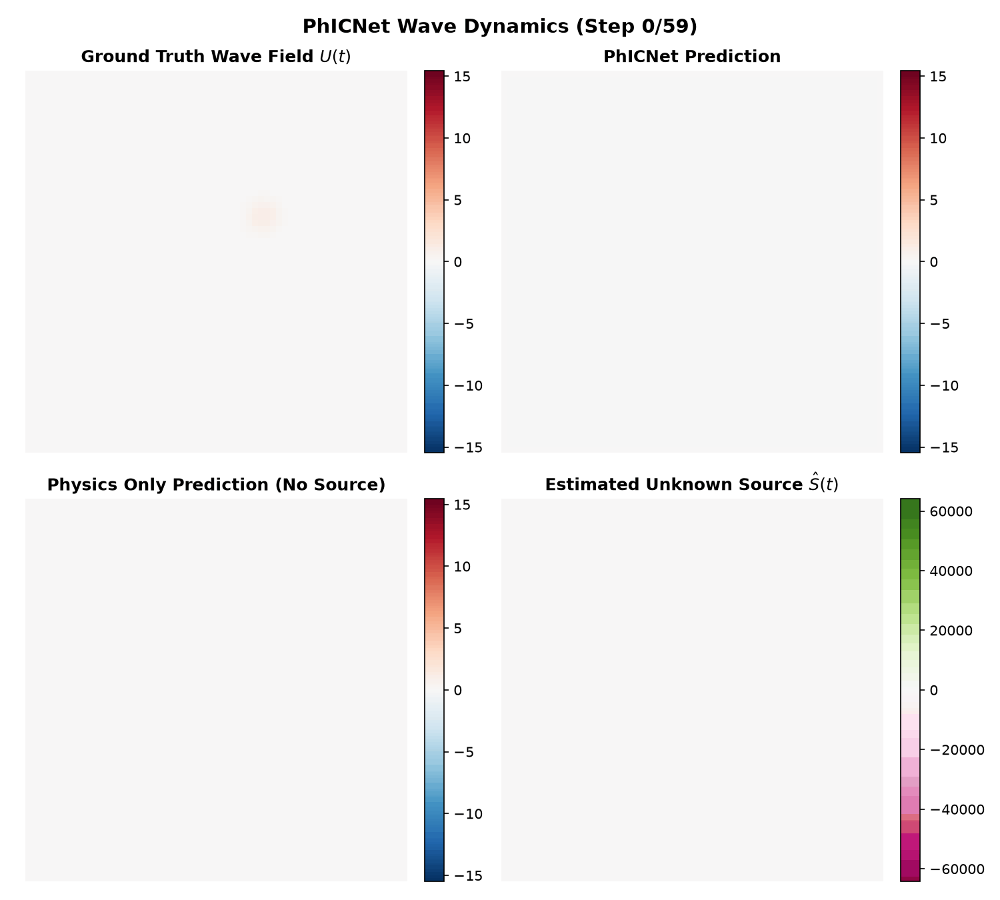

<div align="center">

# 🌊 Wave Propagation System: PhICNet
**Physics-Incorporated Neural Networks for Source Identification and Forecasting**

[](https://www.python.org/downloads/)
[](https://pytorch.org/)
[](https://opensource.org/licenses/MIT)
[](https://streamlit.io/)

A PyTorch implementation of the **Physics-Incorporated Convolutional Recurrent Neural Network (PhICNet)**, specifically engineered to model the **second-order spatiotemporal dynamics** of 2D wave propagation. 

This system bridges the gap between deep learning and classical numerical methods. By fusing a discrete finite-difference physical operator with a Residual Encoder-Decoder Network (RED-Net), it successfully forecasts physical fields while uncovering **completely unobservable, time-varying external perturbations** (e.g., coupled oscillators acting on an elastic membrane).

---


*Showcase: The model observes only the combined wave dynamics $U(t)$ and successfully isolates the hidden, unobservable coupled oscillators $\hat{S}(t)$ while accurately predicting future wave states.*

</div>

## 🚀 Key Features

* **Strict Physics Compliance:** The underlying wave propagation strictly obeys the 2D Wave Equation via a parameter-free finite-difference scheme.
* **Blind Source Separation:** Dynamically recovers the location, shape, and frequency of unknown coupled oscillators without *any* direct source supervision.
* **$K^{th}$ Order Source Dynamics:** Implements a mathematically rigorous $K=2$ temporal memory block combined with a RED-Net to track highly complex, second-order source oscillations.
* **Stable Long-Term Forecasting:** Capable of autoregressive temporal rollouts far beyond the training horizon without exploding gradients or severe phase drift.
* **Interactive Dashboard:** Includes a live Streamlit web application for on-the-fly interactive wave simulations and model inference.

## 🧠 Mathematical Formulation

### The Governing Dynamics
The 2D wave propagation under an external, unobservable perturbation $S(x, y, t)$ is defined by the continuous inhomogeneous Partial Differential Equation (PDE):

$$ \frac{\partial^2 U}{\partial t^2} = c^2 \left( \frac{\partial^2 U}{\partial x^2} + \frac{\partial^2 U}{\partial y^2} \right) + S(x, y, t) $$

Where $c$ represents the wave propagation speed within the medium.

### Discrete Implementation
To allow for stable integration with discrete neural network states, we discretize this second-order system utilizing the Forward-Time Central-Space (FTCS) method:

$$ U^{t+1} = \underbrace{2U^t - U^{t-1} + c^2 \Delta t^2 \nabla^2 U^t}_{\text{Physics Operator } (H_t)} + \underbrace{\Delta t^2 S^t}_{\text{Source Perturbation } (V_t)} $$

## 🏗️ Architecture Design

The architecture of this repository strictly adheres to the $K=2$ system specifications delineated in the PhICNet research.

1. **Physics Branch (PDE-RNN):** Computes the unperturbed, homogeneous physical expectation $H_t$ using the central-difference method over the history buffer $[U^t, U^{t-1}]$.
2. **Discrepancy Extraction:** Isolates the raw physical error $V_t = (U^t - H_{t-1}) / \Delta t^2$, which represents the raw effect of the hidden source.
3. **Source Memory ($C_{V,t}$):** Maintains a multi-channel tensor of the past $K=2$ perturbation estimates $C_{V,t} = [V_t, V_{t-1}]$.
4. **Residual Source Network (RED-Net):** A deep Residual Encoder-Decoder Network $g(C_{V,t})$ predicts the nonlinear evolution of the source.
5. **Finite Difference Weighting ($w_{vc}$):** The final estimated source $\hat{V}_{t+1}$ is computed via a weighted tensor product initialized with the finite difference coefficients of the second derivative `[2.0, -1.0]`:

$$ \hat{V}_{t+1} = w_{vc} \odot C_{V,t} + g(C_{V,t}) $$

## 📂 Project Structure

```text
Wave-Propagation-System/
├── app.py                     # Entry point for the Streamlit dashboard
├── generate_data.py           # Synthetic dataset generator for wave dynamics
├── requirements.txt           # Project dependencies
├── phicnet/
│   ├── app.py                 # Core Streamlit UI logic and visualizations
│   ├── models/
│   │   ├── phicnet.py         # Main PhICNet architecture and baselines
│   │   ├── physics_model.py   # Discrete 2D Wave Equation operator
│   │   └── source_net.py      # K=2 RED-Net implementation
│   ├── physics/
│   │   └── wave_equation.py   # FTCS numerical solver & dataset generator
│   ├── training/
│   │   ├── losses.py          # PDE-residual and sparsity loss functions
│   │   └── train.py           # PyTorch training loop and validation
│   └── visualization/
│       └── visualize.py       # Snapshot and animated GIF generators
├── data/                      # Generated .npz datasets
├── checkpoints/               # Trained model weights
└── outputs/                   # Visualizations and inference results
```

## 🛠️ Installation

Clone the repository and install the dependencies:

```bash
git clone https://github.com/yourusername/Wave-Propagation-System.git
cd Wave-Propagation-System
pip install -r requirements.txt
```

## 💻 Usage Guide

### 1. Dataset Generation
Generate the synthetic 2D wave propagation dataset containing coupled, unobservable oscillating sources. *Parameters $c=2.0$ and $dt=0.005$ ensure strict Courant-Friedrichs-Lewy (CFL) numerical stability.*

```bash
python generate_data.py --train_seqs 300 --val_seqs 50 --test_seqs 50 --seq_len 200 --c 2.0 --dt 0.005
```

### 2. Model Training
Train the PhICNet model end-to-end. The training loop automatically computes the physical discrepancies, optimizes the RED-Net, and enforces $L_1$ source sparsity.

```bash
export PYTHONPATH="."
python phicnet/training/train.py --epochs 25 --batch_size 16 --model phicnet
```

### 3. Inference & Visualization
Generate high-fidelity side-by-side comparative GIFs (like the one at the top of this README) and static multi-panel snapshots for sequences in the test set.

```bash
export PYTHONPATH="."
python phicnet/visualization/visualize.py --seq_idx 0
```

### 4. Interactive Dashboard
Explore the wave dynamics, test out various unknown source distributions (single oscillators, coupled oscillators, pulses), and evaluate the model's predictive power on-the-fly.

```bash
streamlit run app.py
```

---

<div align="center">
<i>Built to push the boundaries of Physics-Informed Machine Learning in higher-order dynamical systems.</i>
</div>
